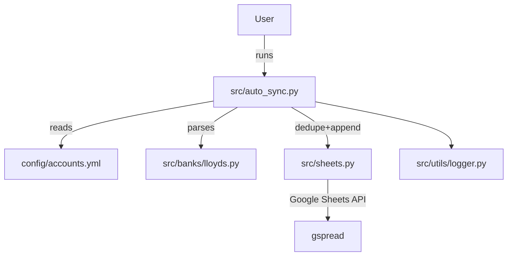
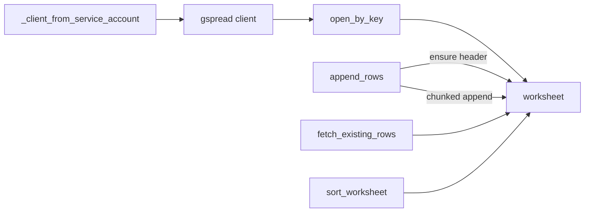

# Architecture Overview

Auto-sync centric view with minimal moving parts.

## Top-level

## sheets internals

Notes
- Tabs are created on demand with the Fina header
- Sorting via batchUpdate after appends (config-driven)
