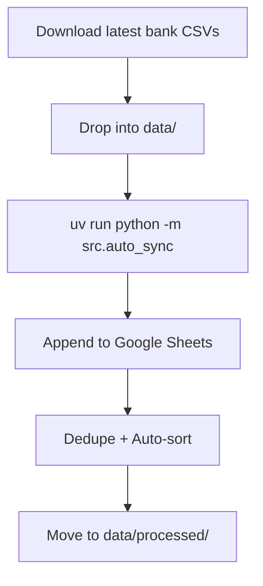

# Fina Converter – Quick Guide

Minimal steps to keep Fina up-to-date via Google Sheets.

## Flow



## Setup (once)

- Put your service account JSON at `credentials/service_account.json`
- Share each spreadsheet with that service account (Editor)
- Configure per-account in `config/accounts.yml`:
  - `sheet_id`, `worksheet`
  - `file_prefixes` to route files (e.g., `50038063`, `4205`)
  - Optional `sort: { column: "Date", ascending: false }`

## Run

```zsh
uv run python -m src.auto_sync
```

## Notes

- Fina reads the FIRST worksheet in a spreadsheet—keep one sheet per account or ensure the import tab is first
- We auto-create tabs with the Fina header if missing
- Preflight checks will warn if a sheet isn’t shared or the ID is wrong

## Troubleshooting

- Not seeing updates? Check logs for preflight errors and verify `sheet_id`/`worksheet`
- Sorting off? Ensure `sort` is set and Date cells are actual dates in Sheets
- Duplicates? We dedupe by Date/Amount/Name/Merchant; description variance can look like new rows
